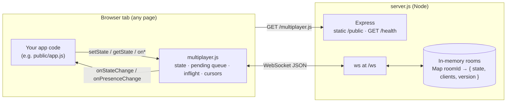
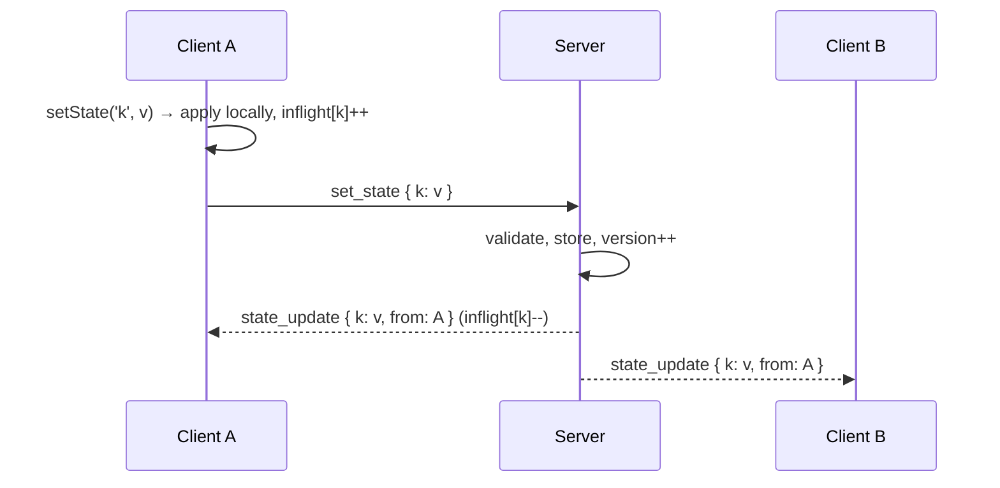

# Architecture



## Write path



## Reconnect + offline queue

```mermaid
sequenceDiagram
  participant A as Client A
  participant S as Server
  A--xS: connection drops
  A->>A: inflight writes moved to pending; status = reconnecting
  A->>A: setState while offline → pending (last write per key)
  A->>S: (backoff 1s, 2s, 4s… ≤ 30s) join { room, clientId }
  S-->>A: welcome, snapshot (authoritative state)
  A->>A: state = snapshot + pending
  A->>S: set_state { ...pending }
  S-->>A: state_update (broadcast to everyone)
```

## Design notes

- **Room id in the URL hash.** Shareable, no server routing, and the hash is never sent in HTTP requests.
- **Server is the ordering authority.** It applies patches in arrival order and broadcasts them with a monotonically increasing `version`. Clients converge on the server's order.
- **Echo suppression.** While a key has unacknowledged local writes, remote values for that key are ignored (the local value will win on the server anyway). If the server rejects a patch, the client sends `sync` and adopts a fresh snapshot.
- **Presence** comes from connected sockets. A reconnecting client reuses its `clientId`, and the server replaces the stale socket (close code 4409), so there are no ghost users.
- **Liveness.** The server pings every 30s and terminates unresponsive sockets. The client pings every 25s and force-reconnects after 62.5s of silence.